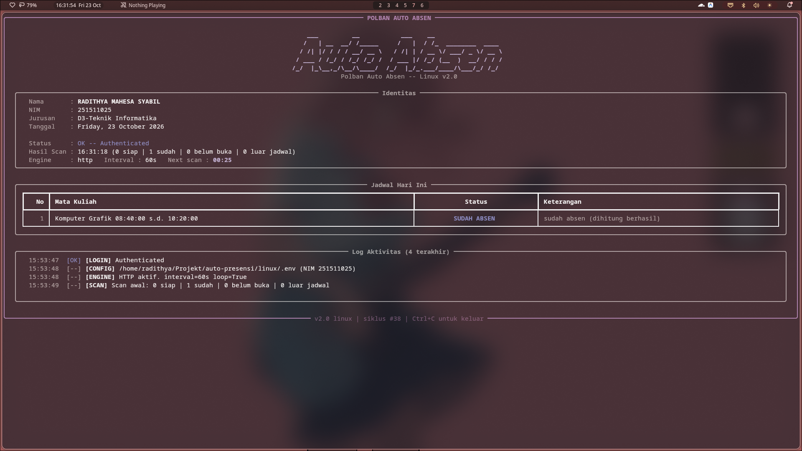

# Polban Auto Absen — Linux (Terminal TUI)

Auto-login + auto-klik tombol absen **biru** di `akademik.polban.ac.id/ajar/absen`.
Versi Linux dengan **live terminal dashboard** — tabel jadwal diupdate in-place,
countdown timer real-time, dan activity log ringkas tanpa output berulang.

---

## Tampilan

<p align="center">
  
</p>

Dashboard berjalan **full-screen di alternate terminal buffer** (seperti `htop`/`btop`) — tidak meninggalkan riwayat scrollback shell dan tidak bisa di-scroll tanpa alasan. Panel diperbarui *in-place*, countdown timer berjalan detik demi detik selama jeda antar-scan, dan log aktivitas hanya mencatat 15 entri penting terakhir.

---

## Quick Start

```bash
cd linux

# 1. Install dependensi
bash install.sh

# 2. Edit .env — isi NIM & password
nano .env

# 3. Tes sekali (mode plain, tanpa live TUI)
bash run.sh --once

# 4. Mode loop (live dashboard)
bash run.sh
```

---

## Argumen CLI

| Argumen | Keterangan |
|---|---|
| `--engine http` | Engine HTTP ringan, tanpa browser (default) |
| `--engine pw` | Engine Playwright (render penuh, butuh `playwright install chromium`) |
| `--once` | Sekali jalan lalu exit (untuk cron). Otomatis plain mode. |
| `--plain` | Paksa mode plain text (tanpa rich TUI) |
| `--dump [FILE]` | Simpan HTML halaman absen ke file lalu exit (diagnostik) |

---

## File

| File | Fungsi |
|---|---|
| `auto_absen.py` | Engine utama (HTTP/Playwright) + integrasi TUI |
| `tui.py` | Modul TUI (rich-based live dashboard) |
| `install.sh` | Installer (cek Python, pip install) |
| `run.sh` | Launcher shortcut |
| `.env.example` | Template config |

---

## Dependensi

| Package | Wajib? | Alasan |
|---|---|---|
| `rich` | Ya | Live dashboard terminal |
| `requests` | Ya | Engine HTTP |
| `beautifulsoup4` | Ya | Parser HTML |
| `playwright` | Opsional | Engine PW (fallback) |

Semua via `pip` — tidak perlu kompilasi.

---

## Mode Plain / Fallback

Jika terminal tidak mendukung ANSI, atau `rich` tidak terinstall, atau `--plain` / `--once`:
- Otomatis fallback ke output teks biasa (tanpa border/tabel/live)
- Tidak crash, tidak ada errors

## Keamanan

- Kredensial disimpan **lokal** (`.env`). Tidak dikirim ke server selain `akademik.polban.ac.id`.
- File `.clicked.json` dan `absen-dump.html` sudah di-`.gitignore`.

---
